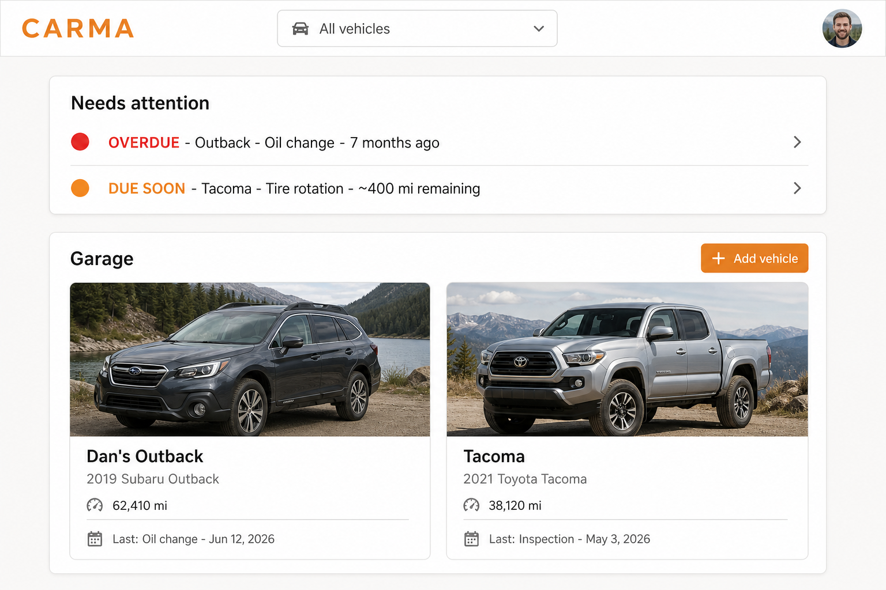
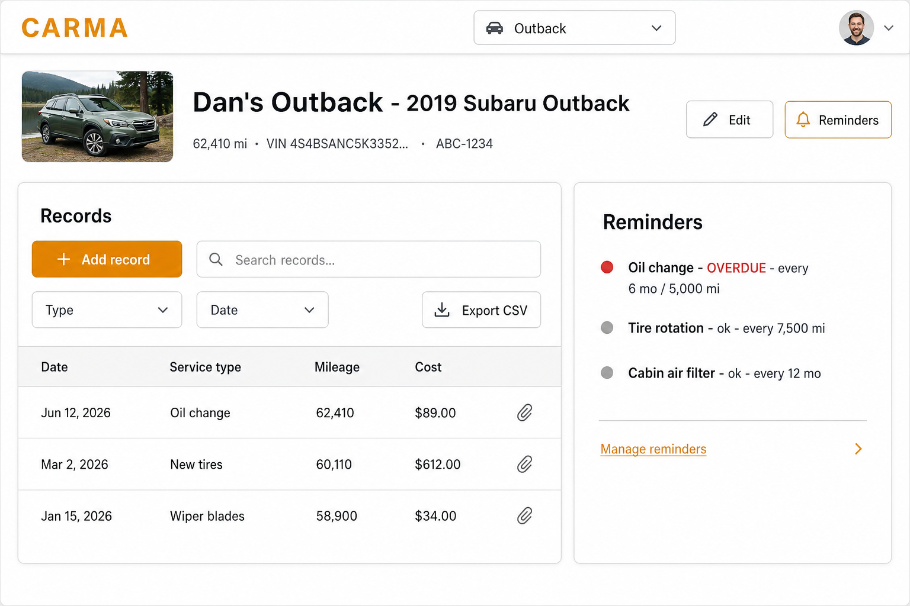

# Carma

A self-hosted vehicle maintenance tracker for the household, planned for
`https://carma.bitofbytes.io`. Track maintenance and repair records across every
car in the garage, attach receipts, get reminded when routine service is due, and
export the history when it's time to sell.

**Status: MVP implemented.** The repository contains the Go/HTMX application,
PostgreSQL migrations, filesystem-backed receipt storage,
container build, and CI workflow described by the project plan.

## Local development

Requirements: Go 1.26.x and Docker. Race-enabled tests also require
`CGO_ENABLED=1`, a [supported OS/architecture](https://go.dev/doc/articles/race_detector#Requirements),
and an installed C compiler on non-macOS systems.

Carma always runs on PostgreSQL: start the
local database with `make db-up` and apply migrations with `make migrate` before
`make run`. Then open `http://localhost:4700` and use the clearly labeled local
developer login. Uploads are written below `.local/carma-assets`; configuration
rejects development auth when `APP_ENV=production`.

Production configuration uses Google OIDC and requires a verified email to match
`AUTH_GOOGLE_ALLOWED_EMAILS` or `AUTH_GOOGLE_ALLOWED_DOMAINS`. The allowlist is
rechecked on every request, so removing an address revokes its existing sessions,
and reminder emails go only to allowlisted users. Expired sessions are purged at
startup and daily.

Due dates, reminder emails, and new-record date defaults use the household
calendar date in `APP_TIMEZONE` (an IANA zone name, default `America/New_York`);
an invalid zone fails startup.

Email reminders are disabled by default. Production enables them with
`REMINDER_EMAIL_ENABLED=true` and:

```text
SMTP_HOST=mail.bitofbytes.io:465
SMTP_USERNAME=carma
SMTP_PASSWORD_FILE=/run/secrets/carma_smtp_password
SMTP_FROM_ADDRESS=carma@bitofbytes.io
SMTP_FROM_NAME=Carma
SMTP_TLS_MODE=implicit
PUBLIC_URL=https://carma.bitofbytes.io
```

When enabled, incomplete configuration fails startup. The scheduler runs at startup
and every 24 hours, sends only overdue reminders through certificate-verified implicit
TLS, and coordinates replicas with a PostgreSQL advisory lock. Successful deliveries
are audited and suppress repeats for the exact rolling prior 30 days. The image also
provides `/app/carma-reminders` with `--dry-run` and `--reminder-id <uuid>`.
For production proofs, add `--require-recipient-count <n>` to a targeted run; it
compares only the normalized recipient count and refuses to send or audit on a
mismatch. Recipient addresses cannot be supplied or overridden through the CLI.

Reminder email also sends a weekly digest over the same SMTP settings: from
Monday 08:00 household time, one summary per week of every overdue and due-soon
reminder grouped by vehicle, led by any NHTSA recalls found since the last digest.
Each recall is announced once and never once dismissed; it links to NHTSA's lookup
for the vehicle's VIN (when the VIN is valid) and to the vehicle page, where it can
be dismissed. Weeks with nothing to report send nothing. Preview it without
sending using `/app/carma-reminders --digest --dry-run`; `--digest` alone sends this
week's digest now unless it has already gone out, nothing is due, or it is still
before Monday 08:00 household time (each of these is a no-op, not a failure).
`/app/carma-reminders --check-recalls` runs the recall check once for every vehicle
due one, without sending email.

NHTSA lookups are always on. The vehicle form has a "Decode VIN" button that fills
in year, make, and model from NHTSA's free vPIC API, and a recall check, under its
own advisory lock, fetches NHTSA safety recalls for each active vehicle's year, make,
and model about once a week (and again right after any of them is edited). Open
recalls appear in "Needs attention" and on the vehicle page, where they can be
dismissed once fixed or not applicable. A vehicle's first check (and the first after
its year, make, or model changes) only sets a baseline; campaigns NHTSA adds after
that are emailed in the weekly digest when reminder email is on. Both APIs are keyless; the containers only
need outbound HTTPS to `vpic.nhtsa.dot.gov` and `api.nhtsa.gov`.

Validation commands are `make test`, `make lint`, `make build`, and `make vuln`.
Both `make test` (also used in CI) and `make test-integration` run the Go race
detector; a detected race fails the test run.
The lint target lists unformatted Go files without rewriting them, then runs
`go vet` and pinned `staticcheck@v0.8.2` using the project's Go toolchain. Run
`gofmt -w` on the listed files to fix formatting; the first staticcheck run may
download its pinned tool dependencies.
The vulnerability target runs the pinned `govulncheck@v1.6.0` with the Go version
declared by this project. The HTTP handler and repository tests need PostgreSQL:
`make test` skips them unless `CARMA_TEST_DATABASE_URL` is set, so run
`make test-integration` to start the local Compose Postgres and run the whole suite
against it, each test in its own migrated schema. CI sets the variable, and those
tests fail there if it is missing.

The server also runs asset cleanup at startup and every seven days.
Only generated, unreferenced objects and `temporary/upload-*` files older than 48
hours are eligible. Replicas coordinate with a dedicated PostgreSQL advisory lock.
Every attempt emits `asset cleanup started` followed by exactly one of `asset cleanup
completed`, `asset cleanup skipped`, or `asset cleanup failed`. Completion/failure
events include scan, retention, pruning, failure, and reclaimed-byte counters;
partial deletion failures are reported as failed runs while preserving successful
deletion totals. For example, this LogQL query shows the latest terminal runs and
the number of files and bytes pruned (adjust the service label to match the Loki
deployment):

```logql
{service_name="proxy_carma"} | json | msg=~"asset cleanup (completed|failed|skipped)" | line_format "{{.time}} run={{.run_id}} status={{.msg}} objects={{.orphan_objects_pruned}} temporary={{.stale_temporary_files_pruned}} bytes={{.bytes_reclaimed}}"
```

In Grafana, run it newest-first with a line limit of one to confirm the latest run.

The leader jobs (asset cleanup, reminder email, the weekly digest, and the recall
check) each hold their advisory lock on a connection of their own, outside the
`DATABASE_URL` pool, for the whole run, while their queries go through the pool.
A replica that wins every lock therefore opens up to four extra database
connections, which the `pgxpool_*` metrics do not count, and the pool needs no
slots set aside for locks: pgx's default size (`pool_max_conns`, the larger of 4
and the CPU count) still serves HTTP while all four jobs run. Each scheduled run
is cut off after 30 minutes, which logs `background job timed out` and releases
its lock.

Prometheus metrics are served at `GET /metrics` on a separate internal listener,
never on the public port, so the public Traefik routers cannot expose them.
`METRICS_ADDR` sets its address (optional, default `:9464`; `off` disables it).
If the address cannot be bound the error is logged and Carma keeps serving. The
port is not in the Dockerfile's `EXPOSE`; Prometheus scrapes it over the overlay
network. The listener exports:

- `http_requests_total` and `http_request_duration_seconds` by `method`, `route`
  (the chi route pattern such as `/vehicles/{vehicleID}`, or `unmatched`), and
  `code`. `/health`, `/ready`, and `/metrics` are not recorded.
- `pgxpool_*` connection pool stats: acquired, idle, total, max, and constructing
  connections, plus acquire counts and wait time.
- `carma_oauth_failures_total{provider,reason}`: Google callbacks with an invalid
  or expired `state`, or a failed code `exchange`.
- `carma_login_failures_total{reason}`: sign-ins refused after Google, by
  `not_invited`, `account_conflict`, or `error`.
- `carma_uploads_total{kind,result}`: `receipt` and `vehicle_photo` files stored
  (`success`); refused (`rejected`) because they were too large or an unsupported
  type, or were discarded with an invalid form or a refused receipt in the same
  upload; or failed (`failure`).
- `carma_jobs_total{job,result}`: background runs of `session_cleanup`,
  `asset_cleanup`, `reminder_email`, `reminder_digest`, and `recall_check`.
- The Go runtime (`go_*`) and process (`process_*`) collectors.

## What it will do

- **Vehicles** - manage the whole household garage; every allowlisted user sees
  and edits the same vehicles. A one-field mileage update on each dashboard card
  and vehicle page keeps mileage reminders current and records every reading.
- **Records** - log service/repairs with date, type, odometer, cost, vendor, and
  notes; search, sort, and filter the history.
- **Receipts** - attach PDF/photo receipts to any record; stored on the NAS, no
  more glove-box paper.
- **Reminders** - time- and/or mileage-based intervals per vehicle and service
  type, with common starter presets offered when adding a vehicle; overdue and
  due-soon surfaced on the dashboard, with overdue email delivery.
- **Export** - filtered CSV (XLSX later) of any records view.

## How it will be built

Go monolith + HTMX (the dined pattern), single Docker image, Postgres on bahamut,
receipts on an NFS volume, deployed to the crystal1 Docker Swarm by the standard
GitHub Actions → Tailscale registry → bare-repo post-receive pipeline. Stack file,
Traefik route, and deploy hook will live in `home_swarm` as usual.

## Documentation

| Doc | Contents |
|---|---|
| [docs/PRD.md](docs/PRD.md) | Features, MVP vs stretch scope, data model, permissions, acceptance criteria |
| [docs/ARCHITECTURE.md](docs/ARCHITECTURE.md) | Stack decisions, repo layout, storage, reminder engine, CI/CD flow |
| [docs/INFRA.md](docs/INFRA.md) | Naming, stack/Traefik/hook definitions for home_swarm, one-time bootstrap checklist |
| [docs/UI.md](docs/UI.md) | User flows, screen wireframes, HTMX interaction notes |
| [docs/mockups/](docs/mockups/) | Visual mockups of the key screens |

## Design preview




